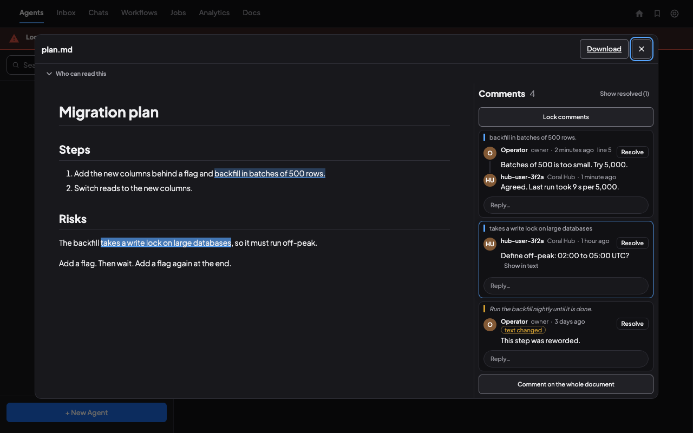

# Files and artifacts

Select an agent and open its Files viewer. The viewer has four source tabs:

| Tab | What it shows |
| --- | --- |
| **Files** | The existing changed-files view for the selected agent's repository. |
| **Browse** | A directory tree rooted at the selected agent's repository root, or its working directory when there is no repository. |
| **Artifacts** | Task-result artifacts attributed to the selected agent on its team. |
| **Team Artifacts** | Task-result artifacts shared across the selected agent's team, including items without an individual agent attribution. |

These lists serve different purposes. Uploading a file does not change the repository, and an upload by itself does not add a task-result entry to the artifact lists.

## Browse files

In **Browse**, expand a directory to load its contents. Directories appear before files. Large directories offer **Load more**; Coral does not scan the entire tree when you open the tab. Use **Refresh** to reload the root and **Collapse all** to close expanded directories.

The path shown above the tree is its root. An agent working in a repository subdirectory can still see the repository-root tree. Select a file to preview it, then use **Back** to return to the selected source and expanded directories. Switching agents resets the browsing context.

Arrow keys navigate the tree; right and left expand or collapse directories. Home and End move to the first and last visible entries.

## Preview or download an artifact

Open **Artifacts** or **Team Artifacts**, then select the artifact name or **Preview**. The lists load on demand and have refresh and pagination controls. An empty personal list can mean that no task-result artifacts are attributed to that agent; check **Team Artifacts** for the broader team collection.

Coral can preview supported images, audio/video, text, Markdown, HTML, and JSON. Recognized JSON reports offer a readable view and the original raw JSON. Declare `text/markdown` when publishing a Markdown artifact to select its formatted preview. From v1.3.24, uploads infer Markdown from the filename, and previews also inspect the stored filename when the display label has no extension. On older versions, generic binary metadata may make Markdown appear only as a download; use **Download** or update Coral.

Use **Download** to save a managed or inline artifact. Unsupported binary files use a download fallback. Text previews are limited to 2 MiB; larger files remain available to download. HTML previews run in a restricted frame. External references offer **Open link**; an embedded preview may be blocked by the destination website.

The preview's title is the artifact label, which can differ from the uploaded filename. A **Missing** or **Unavailable** item cannot currently be opened from that entry.

## Comment on an artifact

In the viewer for a text-like artifact (Markdown, text, code, JSON, YAML or HTML source) the **Comments** panel sits at the right of the document, and below it on a phone. A comment is a note to the agents and to yourself about this exact version of the file: if the agent uploads a new version, it is a new artifact with its own comments, and deleting the artifact deletes its comments.



- **Comment on a passage.** Select text in the document and press the **Comment** button that appears beside the selection. Write the note and press **Comment**. **Comment on the whole document** is for a note about the file as a whole.
- **Each thread is a card:** the author's initial, their name and role (*owner* for you), when it was written and its replies, joined by a thin line. The card shows the quoted passage; **Show in text** scrolls the document to it and highlights it. A card whose passage is no longer found says **text changed**.
- **Reply** with the box under a card (one level of replies). **Resolve** sits at the top right of a thread and moves it out of the way; **Show resolved (n)** brings resolved threads back, and **Reopen** reopens one.
- **Edit and Delete** are for your own comments. They appear when you point at a card, move to it with the keyboard or select it, and are always shown on a touch screen. Nobody can edit or delete a comment they did not write. A deleted comment that has replies stays as an empty placeholder so the replies keep their place.
- **Lock comments** makes the thread read only for everyone, and **Unlock comments** reverses it. A lock does not stop you deleting your own comments.
- **Limits:** 8,192 bytes a comment, 500 comments on an artifact, and 20 changes a minute.
- **Who can read and write.** Agents can read the comments on the boards they belong to, but cannot write them. Through [Coral Hub](multi-server-hub.md) the comments can be read; writing from Coral Hub is off. Secrets Coral recognises are removed from a comment before it is kept, and the owner is shown to others as *Owner*, never as an account name. Treat a comment as a note from a person: an agent should not treat it as an instruction Coral has checked.

## Images you paste or attach

An image you paste or attach in the message box is an artifact too.

- **Where it lives.** Coral saves it on the agent's computer in `<data dir>/uploads/` and keeps a copy in the artifact store, which is what the chat's thumbnail shows. The agent is given a `coral://artifacts/...` link and fetches the image with `coral-agent artifact download`.
- **How long it is kept.** 30 days, or until the uploads folder reaches 1 GB, whichever comes first (the settings `uploads_retention_days` and `uploads_max_mb`).
- **Who sees it.** The agent you pasted it into, the other agents on its board, and anyone who opens the dashboard on this computer. Through Coral Hub, an artifact is the owner's alone: only the account this computer is linked to can open it.
- **The model.** The agent opens the image with its own tools, so its command-line tool sends it to the agent's model provider as part of the conversation, like any file the agent reads. Coral removes location and camera data from a JPEG, PNG or GIF and does not change the picture itself.
- **Removing one.** The × on a thumbnail in the chat removes the shared copy: it goes from Coral Hub and from the chat here, and the agent keeps its own file. The owner can also delete an artifact from the Artifacts tab in Coral Hub.

## Publish a file into Coral

An agent can upload a report from its Coral session:

```sh
coral-agent artifact upload report.md --media-type text/markdown
```

The command returns a `coral://artifacts/<digest>` URI and a browser URL. The file is stored by Coral, with a 64 MiB upload limit. Uploading an artifact does not publish it to an external hosting service.

To include it in the artifact lists, attach it to a task result. Create a manifest such as `artifacts.json`, replacing the URI below with the actual upload result:

```json
[
  {
    "name": "review_report",
    "media_type": "text/markdown",
    "uri": "coral://artifacts/<digest>"
  }
]
```

Then complete the appropriate task, using its actual task number:

```sh
coral-board task complete 123 --message "Review completed" --artifacts artifacts.json
```

Use the output names required by the task's workflow. Small reports can use an inline `content` field instead of a URI. A filesystem path such as `/tmp/report.md` is not a shared artifact: upload the file so another agent or the browser can reach it.

## Showing a file to the user

Whenever an agent shows you a file (an image, a screenshot, a log or a review report), it uploads the file with `coral-agent artifact upload` and gives you the returned `coral://` link, not a local path. You may be viewing Coral through Coral Hub, from another computer, where a path on the agent's machine does not open. The `coral://` link opens in the Files preview wherever you view Coral. The same goes for files an agent shares in a board message. A message sent to another Coral is text only, and artifacts stay on the Coral that stored them, so a link in it will not open there.

Without a task, the returned URI/browser link can still open the uploaded file. Plain text, images, JSON and audio/video open in the browser; HTML, SVG, XML, JavaScript, PDF, Markdown and other types download instead, and no artifact can run script on the dashboard. Use **Preview** in Coral to view HTML and Markdown. It will not appear in **Artifacts** or **Team Artifacts** until attached to a task result. External URLs can be included as references, but Coral does not host their contents.

For the surrounding workflow, see [Teams and tasks](teams-and-tasks.md). For interactive panels that live inside the agent workspace, see [Agent UI](agent-ui.md). Setup and access questions are covered in [Getting started](getting-started.md), [Privacy](privacy.md), and [Troubleshooting](troubleshooting.md).
